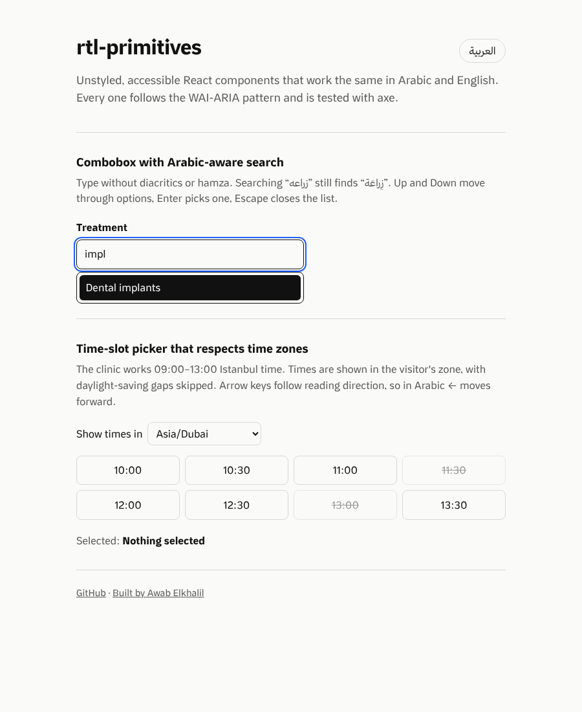

# rtl-primitives

Accessible, unstyled React components that work in Arabic and right-to-left layouts as well as they do in English.

**Live demo:** [awabadam.github.io/rtl-primitives](https://awabadam.github.io/rtl-primitives/)

| English | العربية |
| --- | --- |
|  |  |

Most component libraries are built in English and adapted for RTL afterwards. These are built for both from the start. I wrote them after shipping a 9-language patient site with RTL Arabic and Farsi, where the same problems kept coming back.

## What's inside

### `Combobox` / `useCombobox`

An editable combobox with list autocomplete, following the [WAI-ARIA 1.2 combobox pattern](https://www.w3.org/WAI/ARIA/apg/patterns/combobox/).

- **Arabic-aware search.** Strips harakat and tatweel, treats the forms of alef (أ إ آ ٱ) as the same letter, matches ة with ه and ى with ي, and reads Arabic-Indic and Persian digits as Western digits. Typing "زراعه" finds "زِراعَة".
- **Keyboard:** Up/Down to move, Enter to pick, Escape to close (a second Escape clears), Tab to leave. `aria-activedescendant` keeps focus in the input.
- **Headless:** the hook returns prop getters, so you render whatever markup and styles you like. `Combobox` is a reference component built on it.

### `TimeSlotPicker` / `useSlotGrid`

A grid of bookable times for a business in one time zone and a visitor in another.

- **Correct across time zones and daylight saving.** Times are generated as wall-clock times in the business's IANA zone and stored as UTC instants. Times that don't exist on a daylight-saving change day are skipped. Everything is built on `Intl`, with no date library.
- **Shown in the viewer's locale and zone.** `ar-EG` gives Arabic-Indic digits and ص/م, and `displayTimeZone` shows the same slot in Dubai time.
- **RTL-correct arrow keys.** Left and Right follow reading order, so in Arabic ← moves to the next time. Up/Down move a row, and Home/End jump to the start or end of a row (with Ctrl, of the whole grid). Disabled slots are skipped.
- **One tab stop** (roving `tabindex`), with `aria-selected` and `aria-disabled` on each cell.

### Helpers

`normalizeForSearch`, `matchesSearch`, `generateSlots`, `zonedTimeToInstant`, `formatSlot`, `getDirection` and `useDirection` are exported for use on their own.

## Usage

```tsx
import { Combobox, TimeSlotPicker } from "rtl-primitives";

<Combobox
  label="العلاج"
  items={treatments}
  getLabel={(t) => t.ar}
  onSelect={setTreatment}
  emptyMessage="لا يوجد علاج مطابق"
/>

<TimeSlotPicker
  label="المواعيد المتاحة"
  date="2026-11-18"
  timeZone="Europe/Istanbul"   // where the business works
  displayTimeZone="Asia/Dubai" // where the patient is
  start="09:00"
  end="13:00"
  stepMinutes={30}
  locale="ar-EG"
  value={slot?.iso}
  onChange={setSlot}
/>
```

The components ship no CSS. Style them through their roles and `data-*` attributes: `[data-active]` on the highlighted option, and `[data-selected]` and `[data-disabled]` on time slots. See [`demo/styles.css`](demo/styles.css) for a complete example.

The screenshots use [Thmanyah Sans](https://thmanyah.com). Its license doesn't allow redistributing the font files, so they aren't in this repo: the demo uses Thmanyah Sans if you have it installed and falls back to IBM Plex Sans Arabic.

## Tests

`npm test` runs 31 tests in Vitest with Testing Library:

- keyboard behaviour in both directions, including RTL detected from an ancestor's `dir`
- ARIA state: `aria-expanded`, `aria-activedescendant`, `aria-selected` and `aria-disabled`
- daylight-saving edge cases in London and New York
- an [axe-core](https://github.com/dequelabs/axe-core) accessibility scan on every component, both closed and open

CI runs the type-check, tests, package build and demo build on every push. The demo deploys to GitHub Pages.

## Development

```bash
npm install
npm test           # Vitest + Testing Library + axe
npm run typecheck
npm run build      # ESM + CJS + type declarations with tsup
npm run demo:dev   # demo at localhost:5173
```

## License

MIT. Built by [Awab Elkhalil](https://www.awab.design).
