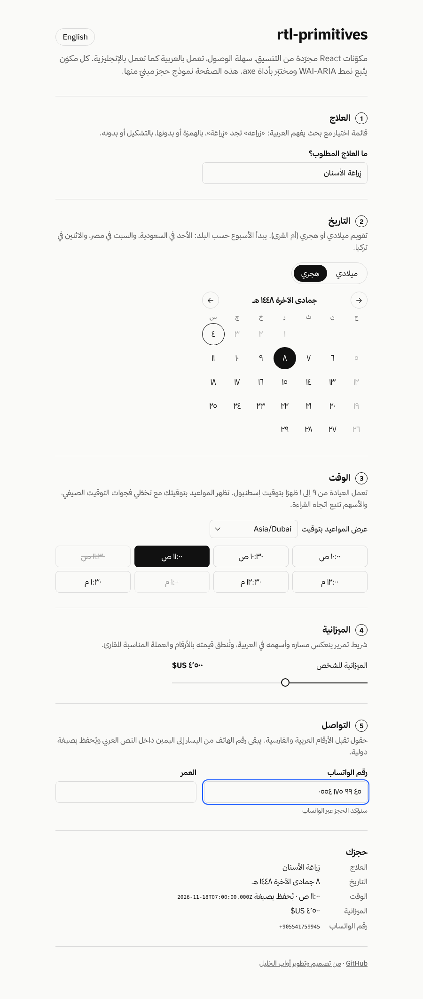

# rtl-primitives

Accessible, unstyled React components that work in Arabic and right-to-left layouts as well as they do in English.

**Live demo:** [awabadam.github.io/rtl-primitives](https://awabadam.github.io/rtl-primitives/)

| English | العربية |
| --- | --- |
|  |  |

The demo page is one booking flow (treatment, date, time, budget, contact) built entirely from these components.

Most component libraries are built in English and adapted for RTL afterwards. These are built for both from the start. I wrote them after shipping a 9-language patient site with RTL Arabic and Farsi, where the same problems kept coming back.

## What's inside

| Component | What it gets right |
| --- | --- |
| [`Combobox`](#combobox--usecombobox) | Arabic-aware search that ignores diacritics and alef forms, WAI-ARIA 1.2 combobox |
| [`Calendar`](#calendar--usecalendar) | Any `Intl` calendar, including Umm al-Qura Hijri; week start from locale data; RTL arrow keys |
| [`TimeSlotPicker`](#timeslotpicker--useslotgrid) | Business time zone in, visitor time zone out, daylight-saving gaps skipped |
| [`Slider`](#slider--useslider) | Track, pointer and arrow keys flip in RTL; value spoken in the reader's numerals and currency |
| [`Tabs`](#tabs--usetabs) | Left/Right follow reading order; automatic or manual activation |
| [`NumberField`, `PhoneField`](#numberfield-and-phonefield) | Accept Arabic-Indic and Persian digits; phone stays LTR in RTL text and is stored as E.164 |

Every component ships as a headless hook (prop getters, no markup or CSS) and an unstyled reference component built on it.

### `Combobox` / `useCombobox`

An editable combobox with list autocomplete, following the [WAI-ARIA 1.2 combobox pattern](https://www.w3.org/WAI/ARIA/apg/patterns/combobox/).

- **Arabic-aware search.** Strips harakat and tatweel, treats the forms of alef (أ إ آ ٱ) as the same letter, matches ة with ه and ى with ي, and reads Arabic-Indic and Persian digits as Western digits. Typing "زراعه" finds "زِراعَة".
- **Keyboard:** Up/Down to move, Enter to pick, Escape to close (a second Escape clears), Tab to leave. `aria-activedescendant` keeps focus in the input.

### `Calendar` / `useCalendar`

A month grid following the [WAI-ARIA date picker grid](https://www.w3.org/WAI/ARIA/apg/patterns/dialog-modal/examples/datepicker-dialog/).

- **Any calendar `Intl` knows.** `calendar="islamic-umalqura"` gives real Hijri months (29 or 30 days, as Umm al-Qura sets them), and `"persian"` gives the Solar Hijri calendar. Values are always ISO Gregorian dates, so your backend never deals with calendars.
- **Week start from locale data:** Sunday for `ar-SA`, Saturday for `ar-EG`, Monday for `tr-TR` and `en-GB`. You can override it with `weekStartsOn`.
- **Keyboard:** arrows move by day (Left/Right flip in RTL) and Up/Down by week. Home/End go to the start or end of the week, and PageUp/PageDown change month. Focus follows into the new month.
- `aria-current="date"` marks today, and every day has a full spoken label in the locale.

### `TimeSlotPicker` / `useSlotGrid`

A grid of bookable times for a business in one time zone and a visitor in another.

- **Correct across time zones and daylight saving.** Times are generated as wall-clock times in the business's IANA zone and stored as UTC instants. Times that don't exist on a daylight-saving change day are skipped. Built on `Intl`, with no date library.
- **Shown in the viewer's locale and zone.** `ar-EG` gives Arabic-Indic digits and ص/م, and `displayTimeZone` shows the same slot in Dubai time.
- **RTL-correct arrow keys and one tab stop** (roving `tabindex`). Disabled slots are skipped.

### `Slider` / `useSlider`

- In RTL the minimum sits on the right, ArrowLeft increases the value, and a click or drag is measured from the right edge.
- `aria-valuetext` uses `Intl.NumberFormat`, so a screen reader says "US$ ٤٬٥٠٠" in Arabic.
- The track exposes `--rtlp-percent`. Position the thumb with `inset-inline-start: var(--rtlp-percent)` and it lands correctly in both directions.

### `Tabs` / `useTabs`

- WAI-ARIA tabs with automatic or manual activation, Home/End and wrapping.
- In a horizontal tab list, Left and Right follow reading order.

### `NumberField` and `PhoneField`

- Both accept Western, Arabic-Indic (٠-٩) and Persian (۰-۹) digits, plus the Arabic decimal (٫) and thousands (٬) separators.
- `NumberField` shows the value in the viewer's locale on blur, clamps it to `minValue`/`maxValue`, and announces invalid input.
- `PhoneField` keeps "+" and every digit group in typed order inside RTL pages, and aligns to the page's start edge. `dir="ltr"` alone isn't enough here. Arabic-Indic digits are *Arabic Number* characters in the Unicode Bidi Algorithm, so the spaces between groups resolve right-to-left and "٠٥٥٤ ١٧٥ ٩٩" displays as "٩٩ ١٧٥ ٠٥٥٤". The field overrides the bidi algorithm (`phoneInputStyle`) to prevent that. It reports `{ e164, valid }` and adds `countryCode` to local numbers.

### Helpers

`normalizeForSearch`, `matchesSearch`, `parseLocalizedNumber`, `normalizePhone`, `generateSlots`, `zonedTimeToInstant`, `formatSlot`, `monthOf`, `firstDayOfWeek`, `getDirection`, `useDirection` (which follows `dir` changes made after mount, such as a language switch) and `phoneInputStyle` are exported for use on their own.

## Usage

```tsx
import { Combobox, TimeSlotPicker } from "rtl-primitives";

<Combobox
  label="العلاج"
  items={treatments}
  getLabel={(t) => t.ar}
  onSelect={setTreatment}
  emptyMessage="لا يوجد علاج مطابق"
/>

<Calendar
  locale="ar-SA"
  calendar="islamic-umalqura"
  value={date}
  onChange={setDate}             // "2026-11-18": always ISO Gregorian
/>

<TimeSlotPicker
  label="المواعيد المتاحة"
  date={date}
  timeZone="Europe/Istanbul"   // where the business works
  displayTimeZone="Asia/Dubai" // where the patient is
  start="09:00"
  end="13:00"
  stepMinutes={30}
  locale="ar-EG"
  value={slot?.iso}
  onChange={setSlot}
/>
```

The components ship no CSS. Style them through their roles and `data-*` attributes: `[data-active]` on the highlighted option, and `[data-selected]` and `[data-disabled]` on time slots. See [`demo/styles.css`](demo/styles.css) for a complete example.

The screenshots use [Thmanyah Sans](https://thmanyah.com). Its license doesn't allow redistributing the font files, so they aren't in this repo: the demo uses Thmanyah Sans if you have it installed and falls back to IBM Plex Sans Arabic.

## Tests

`npm test` runs 65 tests in Vitest with Testing Library:

- keyboard behaviour in both directions, including RTL detected from an ancestor's `dir`
- ARIA state: `aria-expanded`, `aria-activedescendant`, `aria-selected` and `aria-disabled`
- daylight-saving edge cases in London and New York, and Hijri month boundaries
- number and phone parsing across digit systems
- an [axe-core](https://github.com/dequelabs/axe-core) accessibility scan on every component, both closed and open

CI runs the type-check, tests, package build and demo build on every push. The demo deploys to GitHub Pages.

## Development

```bash
npm install
npm test           # Vitest + Testing Library + axe
npm run typecheck
npm run build      # ESM + CJS + type declarations with tsup
npm run demo:dev   # demo at localhost:5173
```

## License

MIT. Built by [Awab Elkhalil](https://www.awab.design).
